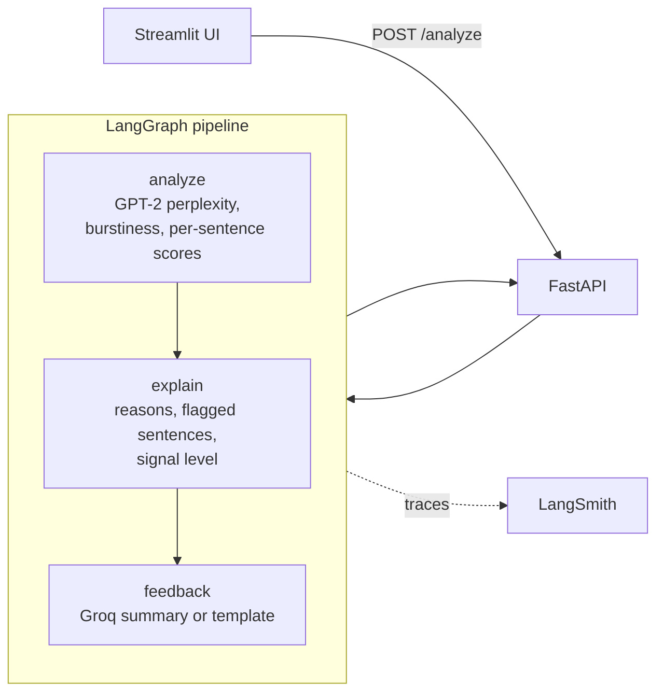

# WriteLens 🔍


**Explainable AI-writing analysis for educators.**

Most AI detectors give teachers one number and no reasons. WriteLens shows *which* sentences look machine-like, explains *why* in plain language, and is honest about how often detectors get it wrong.

> ⚠️ **Scores are signals, not proof.** WriteLens describes statistical patterns in writing, not who wrote it. AI-text detectors, including this one, make mistakes, and are known to flag some human writers more often (for example non-native English speakers and very formal writing). Use the results to start a conversation with a student, never as the only evidence for a decision.

## ✨ What it does

- **Document scores:** GPT-2 perplexity (how predictable the wording is) and burstiness (how much sentence complexity varies).
- **Sentence-by-sentence view:** every sentence gets its own perplexity score, and highly predictable sentences are highlighted.
- **Plain-language reasons:** e.g. *"Sentences are very uniform in complexity. People usually mix simple and complex sentences more."*
- **Cautious signal levels:** "Strong AI-like signals", "Mixed signals" or "Few AI-like signals". Never "written by AI".
- **Teacher-friendly summary (optional):** Groq Llama 3.3 70B turns the scores into a short note with a fair next step. It only sees the scores and flagged sentences, is told not to accuse anyone, and never rewrites the student's text. Without an API key, a built-in template summary is used.
- **Built-in evaluation:** a script that measures accuracy and, most importantly, the false positive rate on real human writing from the HC3 dataset.

## 🏗 Architecture



| Component | File | Role |
|---|---|---|
| Detector | `logic/detector.py` | GPT-2 perplexity, burstiness, sentence splitting and per-sentence scores |
| Explainer | `logic/explainer.py` | Turns numbers into reasons, flags predictable sentences, holds the disclaimer |
| Feedback | `logic/feedback.py` | Optional Groq summary with a template fallback |
| Pipeline | `agent/graph.py` | LangGraph: analyze → explain → feedback |
| API | `backend/api.py` | `POST /analyze` with input validation |
| UI | `frontend/app.py` | Paste text, see scores, highlighted sentences, reasons and summary |
| Evaluation | `scripts/evaluate.py` | Accuracy and false positive rate on HC3 |
| Fine-tuning | `training/finetune_detector.py` | QLoRA classifier on HC3, evaluation questions held out |
| Fine-tuned model | `logic/finetuned_detector.py` | Loads the base model + LoRA adapter and returns P(AI) |

### How the score is built

| Signal | Adds to score |
|---|---|
| Perplexity < 30 | +60 |
| Perplexity 30 to 50 | +40 |
| Perplexity ≥ 50 | +10 |
| Burstiness < 10 | +30 |

The total (0 to 100) maps to a signal level: ≥ 70 strong, 40 to 69 mixed, < 40 few. This is a simple, transparent heuristic on purpose: every point in the score can be explained to a teacher.

## 📏 Evaluation

Run the evaluation on the [HC3](https://huggingface.co/datasets/Hello-SimpleAI/HC3) dataset (human vs ChatGPT answers to the same questions):

```bash
python scripts/evaluate.py --n 200
```

It writes `eval/results.json` and `eval/RESULTS.md` with accuracy, precision, recall and the **false positive rate** (how often human answers get flagged) at two thresholds.

### Results (200 human + 200 ChatGPT answers, seed 42, run on a Colab T4 GPU)

| Flag when | Accuracy | Precision | Recall (AI caught) | False positive rate (humans flagged) |
|---|---|---|---|---|
| Strong AI-like signals (score ≥ 70) | 77.5% | 99.1% | 55.5% | **0.5%** (1 of 200) |
| Mixed or strong (score ≥ 40) | 66.7% | 60.1% | 100.0% | 66.5% (133 of 200) |

| Signal level | Human answers | ChatGPT answers |
|---|---|---|
| Strong AI-like signals | 1 | 111 |
| Mixed signals | 132 | 89 |
| Few AI-like signals | 67 | 0 |

**What this means**

- **"Strong AI-like signals" is trustworthy when it appears.** Only 1 of 200 human answers got this label. But it catches only about half of the ChatGPT answers, so a missing flag does not mean the text is human.
- **"Mixed signals" says very little on its own.** Two in three human answers landed here. That's why WriteLens adds an explicit note to every "Mixed" result saying it is not a reason for concern by itself.
- **No ChatGPT answer scored "Few AI-like signals"**, so that label is a reasonable sign of human-like writing on this dataset.
- These results are for HC3 (ChatGPT answers from early 2023, mostly English Q&A). Newer models, other genres and non-native writers may behave differently.

Full numbers: [`eval/results.json`](eval/results.json).

## 🧪 Fine-tuned detector (QLoRA)

The heuristic is precise but misses about half of AI text. To see whether a trained model does better *without* flagging more human writers, WriteLens includes a fine-tuning pipeline:

| | |
|---|---|
| Base model | `Qwen/Qwen2.5-0.5B` with a sequence-classification head |
| Method | QLoRA: 4-bit NF4 base weights + LoRA adapters (r = 16) on attention projections |
| Data | HC3 human vs ChatGPT answers, balanced, 2,000 per class by default |
| Leakage guard | Every HC3 question used in the evaluation above is removed before training, and the script asserts zero overlap |
| Hardware | Free Colab T4 GPU |

Run it in Colab with [`notebooks/finetune_and_evaluate.ipynb`](notebooks/finetune_and_evaluate.ipynb), or:

```bash
pip install -r requirements-train.txt
pip uninstall -y torchao   # only if an old torchao is installed (e.g. Colab)
python training/finetune_detector.py --per-class 2000 --epochs 1
python scripts/evaluate.py --model finetuned
```

Results go to `eval/results_finetuned.json` and `eval/RESULTS_finetuned.md`, scored on exactly the same 200 + 200 answers as the heuristic.

### Results (same 200 human + 200 ChatGPT answers, Colab T4)

Training: 4,000 examples, 1 epoch, about 5 minutes. 2.2M trainable parameters (0.44% of the model). Validation: 99.5% accuracy, 1% false positive rate, eval loss 0.0097. Details: [`eval/training_metrics_finetuned.json`](eval/training_metrics_finetuned.json).

| Model | Accuracy | Recall (AI caught) | False positive rate (humans flagged) |
|---|---|---|---|
| GPT-2 heuristic, "Strong" level | 77.5% | 55.5% | 0.5% (1 of 200) |
| Fine-tuned Qwen2.5-0.5B (QLoRA) | 100.0% | 100.0% | 0.0% (0 of 200) |

Every human answer landed in "Few AI-like signals" and every ChatGPT answer in "Strong AI-like signals". Full numbers: [`eval/results_finetuned.json`](eval/results_finetuned.json).

**Read this before trusting the 100%**

- The fine-tuned model never saw these 400 answers or their questions (the training script removes them and checks for overlap). So this isn't leakage.
- But it *is* an in-distribution test: same dataset, same question sources, same ChatGPT version (early 2023). HC3's human and ChatGPT answers differ in obvious surface style, which a trained model picks up easily. A perfect score here mainly shows the model learned HC3's patterns.
- What it doesn't show yet: how the model does on text from newer models (GPT-4o, Claude, Llama), on student essays, or on non-native English writing. Those are exactly the cases that matter in a classroom.
- Until that's tested, the app keeps using the explainable GPT-2 heuristic. The fine-tuned model is used in evaluation only, not yet in the app.

Next step: an out-of-distribution test set (essays and newer-model text) to see how much of this score holds up.

## 🚀 Quick Start (Docker)

1. **Clone the repository**
   ```bash
   git clone https://github.com/sandhya-bdb/WriteLens.git writelens
   cd writelens
   ```

2. **Configure environment (optional)**
   ```bash
   cp .env.example .env
   ```
   Add a [Groq API key](https://console.groq.com/keys) for LLM summaries and LangSmith keys for tracing. Both are optional.

3. **Run**
   ```bash
   docker-compose up --build
   ```
   Open [http://localhost:8501](http://localhost:8501).

## 💻 Local Development (No Docker)

```bash
python -m venv venv
source venv/bin/activate
pip install -r requirements.txt

uvicorn backend.api:app --reload --port 8000        # backend
streamlit run frontend/app.py --server.port 8501    # frontend, in a second terminal
```

### API example

```bash
curl -X POST http://localhost:8000/analyze \
  -H "Content-Type: application/json" \
  -d '{"text": "Paste at least three sentences here. ...", "include_feedback": true}'
```

Returns `perplexity`, `burstiness`, `ai_score`, `signal_level`, `reasons`, `sentences` (each with `perplexity` and `flagged`), `summary` and `disclaimer`.

## 🧪 Testing

```bash
pytest tests/ -v
```

Pipeline, API, explainer, feedback and evaluation tests mock GPT-2 and Groq, so they run offline. Detector tests load the real GPT-2 model.

## 🔍 Observability

Set `LANGCHAIN_TRACING_V2=true` and `LANGCHAIN_API_KEY` in `.env` to trace every run in [LangSmith](https://smith.langchain.com/), with each pipeline node as its own span.

## 🧭 Limitations

- GPT-2 perplexity is a weak signal for text from newer models and for short texts. Three or more sentences work best.
- Formal, technical or non-native English writing can look "predictable" and get flagged even when a person wrote it.
- The score is a heuristic, not a trained classifier. The evaluation script exists so these limits are measured, not guessed.

## 📈 Scaling notes

- **GPT-2 in the API worker → dedicated inference server** (vLLM or Triton) so the web server isn't CPU-bound.
- **Streamlit → stateless frontend** (Next.js) for many concurrent users.
- **LLM summaries:** add a router such as LiteLLM for fallback providers and rate-limit handling.

## 📝 Project history

This project started as an experiment in rewriting AI text to pass detectors. It was rebuilt as an analysis-only tool: the rewriting code was removed, and the focus moved to explaining results honestly and measuring false positives, which matter far more in education.

## 📄 License

[MIT License](./LICENSE)
